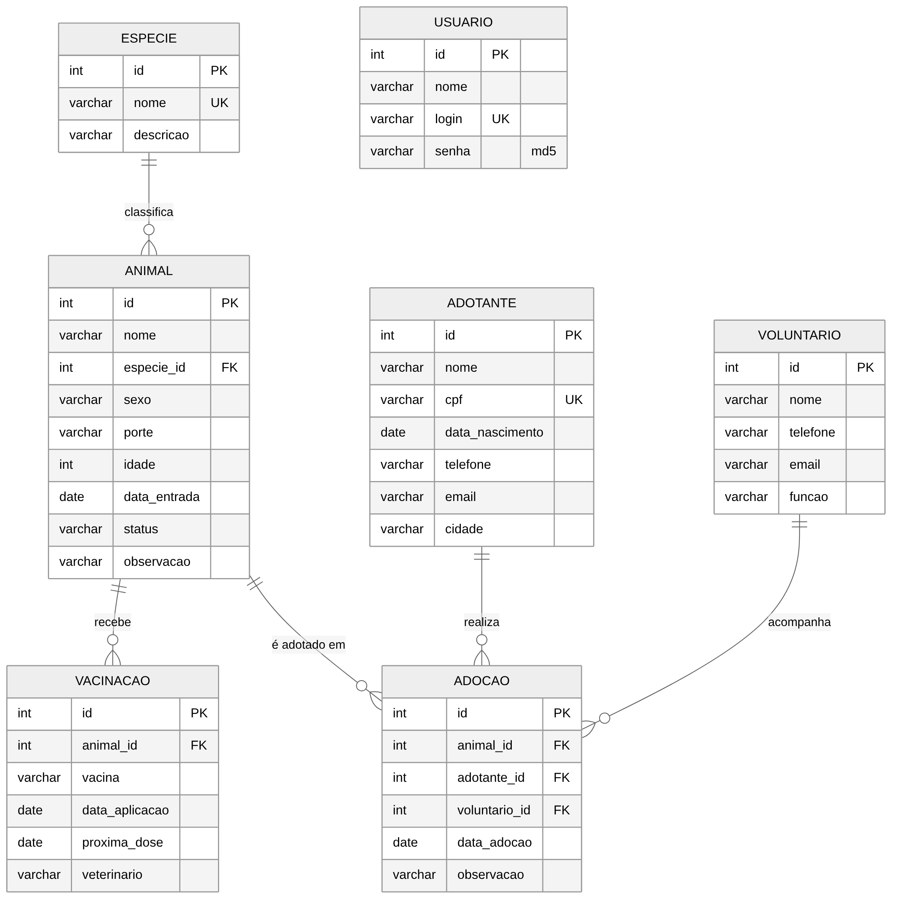

# Banco de Dados – Pet Lar

Banco **`petlar`** (MySQL / MariaDB). O script completo está em [`petlar/banco.sql`](../../petlar/banco.sql).

## Relacionamentos

| Relacionamento | Cardinalidade | Chave estrangeira | Ao excluir o pai |
|---|---|---|---|
| Espécie classifica Animal | 1 : N | `animal.especie_id` | RESTRICT (bloqueia) |
| Animal recebe Vacinação | 1 : N | `vacinacao.animal_id` | CASCADE (apaga as vacinas) |
| Animal é adotado em Adoção | 1 : N | `adocao.animal_id` | RESTRICT |
| Adotante realiza Adoção | 1 : N | `adocao.adotante_id` | RESTRICT |
| Voluntário acompanha Adoção | 1 : N | `adocao.voluntario_id` | RESTRICT |

## Dicionário de dados

PK = chave primária · FK = chave estrangeira · UK = valor único

### usuario
| Campo | Tipo | Nulo | Chave | Descrição |
|---|---|---|---|---|
| id | INTEGER | Não | PK | Identificador (AUTO_INCREMENT) |
| nome | VARCHAR(200) | Não | | Nome exibido no menu |
| login | VARCHAR(100) | Não | UK | Usuário digitado no login |
| senha | VARCHAR(255) | Não | | Senha em MD5 |

### especie
| Campo | Tipo | Nulo | Chave | Descrição |
|---|---|---|---|---|
| id | INTEGER | Não | PK | Identificador |
| nome | VARCHAR(100) | Não | UK | Ex.: Cão, Gato |
| descricao | VARCHAR(255) | Sim | | Texto livre |

### animal
| Campo | Tipo | Nulo | Chave | Descrição |
|---|---|---|---|---|
| id | INTEGER | Não | PK | Identificador |
| nome | VARCHAR(100) | Não | | Nome do animal |
| especie_id | INTEGER | Não | FK | → `especie.id` |
| sexo | VARCHAR(10) | Não | | Macho ou Fêmea |
| porte | VARCHAR(10) | Não | | Pequeno, Médio ou Grande |
| idade | INTEGER | Não | | Idade aproximada (anos) |
| data_entrada | DATE | Não | | Chegada ao abrigo |
| status | VARCHAR(20) | Não | | Disponível, Em tratamento ou Adotado |
| observacao | VARCHAR(255) | Sim | | Temperamento, cuidados |

### adotante
| Campo | Tipo | Nulo | Chave | Descrição |
|---|---|---|---|---|
| id | INTEGER | Não | PK | Identificador |
| nome | VARCHAR(200) | Não | | Nome completo |
| cpf | VARCHAR(14) | Não | UK | 000.000.000-00 |
| data_nascimento | DATE | Não | | Confere maioridade (RN05) |
| telefone | VARCHAR(20) | Não | | Contato |
| email | VARCHAR(150) | Sim | | Contato |
| cidade | VARCHAR(100) | Não | | Cidade ou região |

### voluntario
| Campo | Tipo | Nulo | Chave | Descrição |
|---|---|---|---|---|
| id | INTEGER | Não | PK | Identificador |
| nome | VARCHAR(200) | Não | | Nome completo |
| telefone | VARCHAR(20) | Não | | Contato |
| email | VARCHAR(150) | Sim | | Contato |
| funcao | VARCHAR(100) | Não | | Veterinária, Entrevistador, Cuidadora, Motorista |

### adocao
| Campo | Tipo | Nulo | Chave | Descrição |
|---|---|---|---|---|
| id | INTEGER | Não | PK | Identificador |
| animal_id | INTEGER | Não | FK | → `animal.id` |
| adotante_id | INTEGER | Não | FK | → `adotante.id` |
| voluntario_id | INTEGER | Não | FK | → `voluntario.id` |
| data_adocao | DATE | Não | | Dia da adoção |
| observacao | VARCHAR(255) | Sim | | Anotações |

### vacinacao
| Campo | Tipo | Nulo | Chave | Descrição |
|---|---|---|---|---|
| id | INTEGER | Não | PK | Identificador |
| animal_id | INTEGER | Não | FK | → `animal.id` (CASCADE) |
| vacina | VARCHAR(100) | Não | | Ex.: V10, Antirrábica |
| data_aplicacao | DATE | Não | | Dia da aplicação |
| proxima_dose | DATE | Sim | | Reforço; vazio = dose única |
| veterinario | VARCHAR(200) | Não | | Quem aplicou |
